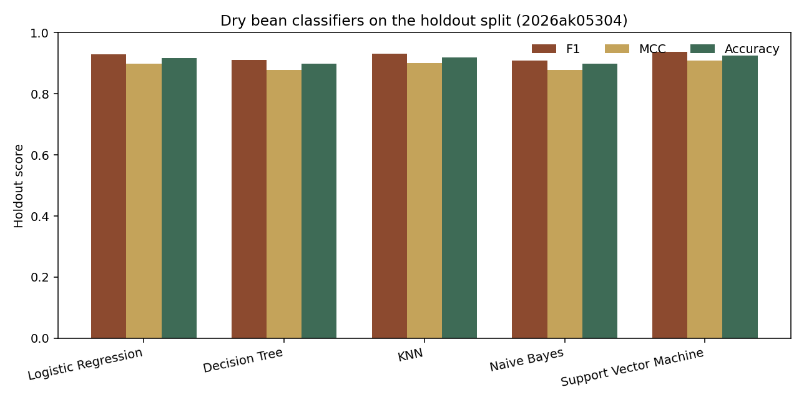

# Dry bean variety classification

Five saved classifiers label a dry-bean grain as one of seven registered varieties. The Streamlit page loads those models and scores a test CSV. It does not retrain them.

## a. Problem statement

Dry beans of different varieties can look alike, and mixed seed is worth less than a uniform lot. Sorting by eye is slow. A camera and a short feature-extraction step can turn one grain into 16 size and shape measurements. This project compares five standard classifiers on that measurement vector and asks which model is the most reliable at recovering the variety label. The decision that matters is the hard label, so the winner is the model with the highest Matthews correlation on a holdout set that was not used to choose settings. Macro F1 is the tie break. Both summaries give the small Bombay class a fair say, which accuracy by itself does not.

## b. Dataset description

The data is the Dry Bean Dataset from the UCI Machine Learning Repository (dataset 602), published by Koklu and Ozkan in 2020. Images of 13,611 grains were reduced to 16 numeric measurements. There is no missing value. The label `Class` has seven varieties. The file is large enough for the assignment: 16 features (the minimum is 12) and 13,611 grains (the minimum is 500).

Source file: `data/Dry_Bean_Dataset.csv`.

Citation: Koklu, M. and Ozkan, I. A. (2020). Multiclass classification of dry beans using computer vision and machine learning techniques. *Computers and Electronics in Agriculture*, 174, 105507. https://doi.org/10.1016/j.compag.2020.105507

UCI page: https://archive.ics.uci.edu/dataset/602/dry+bean+dataset

| Variety | Grains | Share |
| --- | ---: | ---: |
| DERMASON | 3,546 | 26.1% |
| SIRA | 2,636 | 19.4% |
| SEKER | 2,027 | 14.9% |
| HOROZ | 1,928 | 14.2% |
| CALI | 1,630 | 12.0% |
| BARBUNYA | 1,322 | 9.7% |
| BOMBAY | 522 | 3.8% |

The 16 predictors, using the column names in the UCI file, are `Area`, `Perimeter`, `MajorAxisLength`, `MinorAxisLength`, `AspectRation`, `Eccentricity`, `ConvexArea`, `EquivDiameter`, `Extent`, `Solidity`, `roundness`, `Compactness`, `ShapeFactor1`, `ShapeFactor2`, `ShapeFactor3`, and `ShapeFactor4`. `AspectRation` is spelled that way in the original file. Area, perimeter, the two axis lengths, convex area, and equivalent diameter describe size. Aspect ratio, eccentricity, extent, solidity, roundness, compactness, and the four shape factors describe form.

The varieties are not the same shape. Bombay is the large one: mean area about 173,485 pixels, against about 75,538 for Cali, the next largest. Horoz is the long one: mean aspect ratio about 2.03 and compactness about 0.70. Seker is the round one: mean aspect ratio about 1.25 and roundness about 0.94. Dermason and Sira are both smaller and fairly round (mean areas about 32,119 and 44,729). Barbunya and Cali are both large, with Cali a bit longer. Those pairs are where the models spend their mistakes.

Several measurements repeat the same geometry. Area and convex area have correlation 1.000. Compactness and ShapeFactor3 have correlation 0.999. Perimeter and equivalent diameter have correlation 0.991. A model that treats those columns as independent evidence is using the same fact more than once.

The split is stratified, 80/20, `random_state` 42. That gives 10,888 training grains and 2,723 holdout grains. `test_data.csv` is that holdout, with the 16 raw measurements and `Class`. Settings for logistic regression, the tree, and KNN were chosen by 5-fold macro F1 on the training split only. The holdout was scored once, after the models were fit.

## c. Github Repository Link

Replace the two placeholders after the repository is pushed and the app is deployed.

- GitHub repository: `https://github.com/2026ak05304/AIML.git`
- Live Streamlit app: `https://2026ak05304-ml.streamlit.app/`

The repository contains:

```text
app.py                  Streamlit page. Loads saved models and does not call fit.
train_models.py         Trains the five models and writes test_data.csv.
evaluate.py             Shared accuracy, AUC, precision, recall, F1, and MCC.
requirements.txt
README.md
test_data.csv           Holdout file used in the table below.
data/Dry_Bean_Dataset.csv
model/logistic_regression.joblib
model/decision_tree.joblib
model/knn.joblib
model/naive_bayes.joblib
model/svm.joblib
model/training_report.json
```

Each joblib file is a scikit-learn pipeline. The first step is a `StandardScaler` fit on the training rows only. The second step is the classifier. Uploaded test rows are raw measurements, and the pipeline scales them with the saved training mean and variance.

## d. Models used

All five models were trained on the same split of the same dataset.

| ML Model Name | Accuracy | AUC | Precision | Recall | F1 | MCC |
| --- | ---: | ---: | ---: | ---: | ---: | ---: |
| Logistic Regression | 0.9163 | 0.9944 | 0.9303 | 0.9307 | 0.9300 | 0.8992 |
| Decision Tree | 0.8986 | 0.9746 | 0.9100 | 0.9123 | 0.9110 | 0.8778 |
| KNN | 0.9185 | 0.9879 | 0.9343 | 0.9293 | 0.9315 | 0.9014 |
| Naive Bayes | 0.8979 | 0.9916 | 0.9112 | 0.9092 | 0.9091 | 0.8773 |
| Support Vector Machine | 0.9247 | 0.9914 | 0.9357 | 0.9372 | 0.9363 | 0.9092 |

Precision, recall, and F1 are macro averages across the seven varieties, so Bombay counts the same as Dermason. AUC is the unweighted mean of seven one-versus-rest ROC curves. Logistic regression, the tree, KNN, and naive Bayes use predicted probabilities for those curves. The SVM was saved without probability estimates, so its curves use the decision score for each variety. Matthews correlation is the multiclass MCC.

Settings behind the table:

- Logistic regression: `C = 0.1`, `max_iter = 2000`, `class_weight = "balanced"`. Training macro F1 was 0.9341 for `C = 0.1`, 0.9332 for `C = 1`, and 0.9338 for `C = 10`.
- Decision tree: `max_depth = 10`, `min_samples_leaf = 5`, `class_weight = "balanced"`. Depth 10 had training macro F1 0.9193. Depth 6 was 0.9079 and an unlimited tree was 0.9172.
- KNN: 11 neighbours, distance weights, Euclidean distance after scaling. Training macro F1 was 0.9376 for `k = 11`, just above 0.9371 for `k = 7`.
- Naive Bayes: `GaussianNB` with the prior estimated from the training labels.
- Support vector machine: RBF kernel, `C = 1`, `gamma = "scale"`, `class_weight = "balanced"`. These values were fixed before the test set was scored. An RBF grid search on 10,888 rows was not worth the cost, and this untuned SVM still came first.

The search moved the training scores only in the third digit. The family of model matters more than the exact `C`, depth, or `k`.



### Observations

| ML Model Name | Observation about model performance |
| --- | --- |
| Logistic Regression | Best probability ranking of the five, with AUC 0.9944, and third on the hard-label metrics (accuracy 0.9163, macro F1 0.9300, MCC 0.8992). A linear boundary on standardized measurements is enough to separate most grains. Every one of the 104 Bombay test grains is correct. The errors that remain are local: 73 Dermason grains are called Sira and 31 Sira grains are called Dermason. Dermason recall is 0.876, below KNN, which is consistent with balanced class weights giving up some of the largest class. Stronger regularization (`C = 0.1`) was slightly better in training than a more flexible fit. That is reasonable when Area and ConvexArea are the same measurement twice. |
| Decision Tree | Weakest ranker (AUC 0.9746) and tied with naive Bayes at the bottom of the hard-label scores (accuracy 0.8986, MCC 0.8778). Depth 10 was better than a deeper tree, so growing until the leaves are pure does not help this overlap. Bombay is still perfect. The tree is the most confused about Barbunya and Cali, with 27 Barbunya called Cali and 21 Cali called Barbunya. Dermason and Sira account for 66 and 42 errors. Importance is spread across minor axis (0.185), ShapeFactor1 (0.164), major axis (0.157), ShapeFactor3 (0.145), and perimeter (0.120), so the tree is not simply cutting on Bombay's area. A tree probability is constant inside each leaf, so the ROC curve has coarser steps than a smooth score. That is why AUC lags the other models even though accuracy is close to naive Bayes. |
| KNN | Second on every hard-label summary: accuracy 0.9185, macro F1 0.9315, MCC 0.9014. Eleven distance-weighted neighbours were selected on the training split. Scaling is doing real work here, because area is in the tens or hundreds of thousands and the shape factors are near zero. The two mistakes are almost equal: 51 Dermason grains are called Sira and 52 Sira grains are called Dermason. The other four models make the first of those mistakes more often than the second. Dermason recall is 0.908, the best of the five, but Barbunya recall is only 0.875 and 21 Barbunya grains are called Cali. KNN has no class-weight parameter, so the dense Dermason region keeps more of its own grains. |
| Naive Bayes | Lowest accuracy (0.8979) and lowest MCC (0.8773), with macro F1 0.9091. AUC is still 0.9916, close to the SVM, so each variety is separated from the rest about as well as the stronger models separate it. The chosen label is wrong more often, especially on Barbunya. The independence assumption is false in this file: Area and ConvexArea correlate at 1.000, and Compactness and ShapeFactor3 at 0.999. Treating those copies as separate evidence makes the posterior too confident. Barbunya is where that shows. Recall is 0.796, the worst of the five, and 40 Barbunya grains are called Cali. Bombay recall is still 1.000, because a mean area near 173,000 does not overlap the other varieties. Gaussian Naive Bayes is the right member of the family. The measurements are continuous, not counts, so multinomial Naive Bayes would be a poor match. |
| Support Vector Machine | Best accuracy (0.9247), best macro precision (0.9357), best macro recall (0.9372), best macro F1 (0.9363), and best MCC (0.9092). AUC is 0.9914. That is a little under logistic regression, and the two AUCs are not identical kinds of score: this one is computed from decision scores, the logistic one from probabilities. Both say the ranking is strong. The RBF kernel bends around the two overlaps that a flat boundary only approximates. Barbunya recall is 0.913, the best of the five, and Bombay is perfect. Dermason called Sira is still the largest single cell in the confusion matrix, at 58 grains, with 31 Sira called Dermason. Sira remains the hardest variety for this model too (F1 0.876), but that is the highest Sira F1 of the five. The settings were not searched. A fixed RBF SVM still beat the tuned logistic regression, tree, and KNN. |
| Overall, Winner for your dataset? | Support vector machine. It leads the pre-committed rule (highest holdout MCC) and also leads macro F1, accuracy, precision, and recall, so the winner does not depend on a close tie. KNN is the runner-up and is easier to explain. Logistic regression is the one to prefer if the score itself will be thresholded later, because its probability AUC is the highest. The dataset is mostly easy: every model scores Bombay perfectly, and Horoz and Seker stay in a high band (F1 from 0.933 to 0.959). The gap between 0.90 and 0.92 accuracy is the Dermason/Sira pair and the Barbunya/Cali pair. Those two pairs are close in size and shape, and no model in this set separates them cleanly. |

## Streamlit app

`app.py` is the page to deploy. It does four things the submission asks for.

1. A CSV upload. If nothing is uploaded, the page scores the bundled holdout file `test_data.csv`, which includes the 16 measurements and `Class`.
2. A model dropdown with the five classifiers.
3. Accuracy, AUC, precision, recall, F1, and MCC for the selected model, plus the same metrics for all five models on the current file.
4. A confusion matrix and a per-variety classification report.

The page reads the joblib pipelines from `model/` and calls `predict`. There is no `fit` call in `app.py`.

Run it locally after the packages are installed:

```bash
streamlit run app.py
```

## Reproduce the table

From this folder, with the versions in `requirements.txt`:

```bash
python -m pip install -r requirements.txt
python train_models.py
```

The script prints the comparison table. Run that command on the BITS Virtual Lab and screenshot the printed table there. That screenshot is the lab proof required with the submission. A screenshot from another machine does not replace it.

Library versions used for the saved models and the numbers above are scikit-learn 1.9.1, NumPy 2.5.4, SciPy 1.18.1, pandas 2.2.3, and joblib 1.6.0. Streamlit 1.41.1 serves the page. `runtime.txt` asks Streamlit Community Cloud for Python 3.12.

## Deploy

1. Create a GitHub repository, push this folder, and put the repository URL in section c.
2. Sign in at https://streamlit.io/cloud with the same GitHub account.
3. Create a new app from this repository and branch, with the main file set to `app.py`.
4. Open the live URL, confirm the holdout metrics load, switch the model dropdown, and upload `test_data.csv` once.
5. Put the live URL in section c.
6. Submit one PDF, in this order: GitHub link, Streamlit link, BITS Virtual Lab screenshot, then the text of this README.
